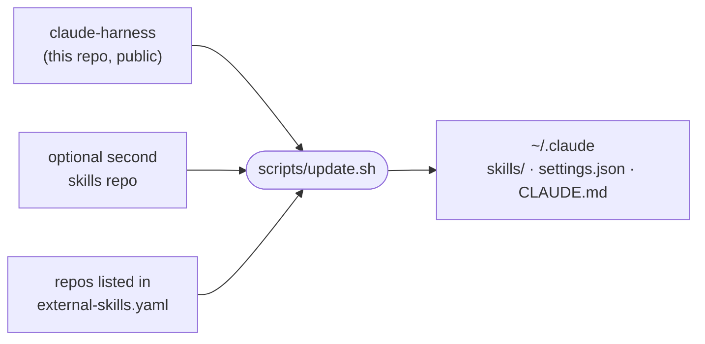

# claude-harness

[](https://github.com/araltiparmak/claude-harness/actions/workflows/check.yml)

A Claude Code setup as code: a set of skills, settings and global instructions, and one script that installs and updates all of it, along with skills from elsewhere.

## How it fits together



`update.sh` pulls this repo and the optional second one, then:

- **Skills:** symlinks every skill into `~/.claude/skills/`, so a pull is all an update needs.
- **Settings:** builds `~/.claude/settings.json` from [`claude/settings.json`](claude/settings.json) plus an optional overlay from the second repo, so private values stay out of this one. If Claude Code or you changed the live file since the last run, the script prints the difference and leaves the file alone, so no setting is lost silently.
- **Global instructions:** links `~/.claude/CLAUDE.md` to [`claude/CLAUDE.md`](claude/CLAUDE.md).
- **Skills from other repos:** [`external-skills.yaml`](external-skills.yaml) lists repo URLs and the skills to take from each. The script clones each repo into `~/.cache/claude-harness/repos`, pulls it on later runs, and links the listed skills. Delete a line and the next run unlinks that skill. `scripts/check.sh` checks the file's format.

[`TOKEN-EFFICIENCY.md`](TOKEN-EFFICIENCY.md) records how plugins, MCP servers, skills and habits are kept cheap in tokens.

## The setup

[`claude/settings.json`](claude/settings.json) in short:

- **Permissions:** auto mode, so there is no allow list: reads and edits in the project run without asking, and the classifier reviews the rest. `terraform apply`/`destroy`, `.env` and AWS credentials are denied.
- **Hooks:** every Claude Code event goes to iTerm2's `cc-status` utility, so the terminal tab shows whether Claude is working, waiting for permission or done.
- **Status line:** [ccstatusline](https://github.com/sirmalloc/ccstatusline).
- **Model:** Opus at high effort, with Sonnet as the fallback model.

## Skills

Skills sit in group folders; `update.sh` links each one into `~/.claude/skills/` by its own name. A folder with a `SKILL.md` is a skill, a folder without one is a group.

### Visuals

| Skill | What it does |
|---|---|
| [deck](skills/visuals/deck/SKILL.md) | Builds presentation decks (PDF, PNG slides or a presentable HTML file) from a JSON spec for a company-wide audience: results, KPIs, team wins, next steps |
| [diagrams](skills/visuals/diagrams/SKILL.md) | Draws technical diagrams (architecture with AWS icons, message chains, sequence, ER, state, flow) as SVG and PNG with Mermaid and D2, plain or hand-drawn (whiteboard style), for PRs and docs |
| [explain](skills/visuals/explain/SKILL.md) | Builds a one-page brief that explains a feature to developers, testers and a PM: scope, architecture (D2, whiteboard style), flow and states (Mermaid), a decision table, rules with test examples, open questions |
| [mindmap](skills/visuals/mindmap/SKILL.md) | Turns a Markdown outline into an interactive mind map (HTML) and a PNG with markmap, for topic trees and study maps |

### Dev

| Skill | What it does |
|---|---|
| [mobile-app](skills/dev/mobile-app/SKILL.md) | Recommends the default stack for a new Expo + React Native + TypeScript app, one decision at a time |
| [react-app](skills/dev/react-app/SKILL.md) | Scaffolds a React + Vite + TS + Tailwind prototype via `cra` (project scripts `check` and `ship` included) and builds v1 (user-invoked: `/react-app`) |
| [vercel](skills/dev/vercel/SKILL.md) | Deploys a Vite/React project to Vercel, or repairs its deploy path |

### Todo

| Skill | What it does |
|---|---|
| [todo](skills/todo/SKILL.md) | Adds an item to the current project's `todo.md` checklist, or ticks one off |

A typical run, from idea to live URL:

```text
/react-app habit-tracker 3        scaffold with cra, verify Tailwind, commit, build v1 at effort 3
/vercel                           pin Node and pnpm, write vercel.json, preview, then production
```

## Use these skills

Install any of the skills above with [skills.sh](https://skills.sh):

```bash
npx skills@latest add araltiparmak/claude-harness
```

`react-app` ships its own scaffolder, [`cra.sh`](skills/dev/react-app/cra.sh). It needs Node 24, and creates projects in the folder named by `CRA_DIR` (default `~/dev`).

## Install the whole setup

```bash
git clone https://github.com/araltiparmak/claude-harness.git
claude-harness/scripts/update.sh
```

Plugins are installed by hand: `claude plugin install frontend-design@claude-plugins-official`, and a plugin only one project uses with `--scope project` from that project's folder. A plugin from another marketplace declares that marketplace in the project too, so it stays out of the global settings. For Cloudflare: `claude plugin marketplace add cloudflare/skills --scope project`, then `claude plugin install cloudflare@cloudflare --scope project`. Leave Matt Pocock's `mattpocock-skills` plugin uninstalled; `external-skills.yaml` already links his skills, and the plugin would load them twice.

A second skills repo is optional: point `PRIVATE_DIR` at a checkout (default `~/dev/private-skills`), and set `PRIVATE_URL` to clone it when the folder is missing. Without either, only this repo is installed. `scripts/check.sh` checks the repo's consistency and runs in CI on every push.

## License

[MIT](LICENSE)
