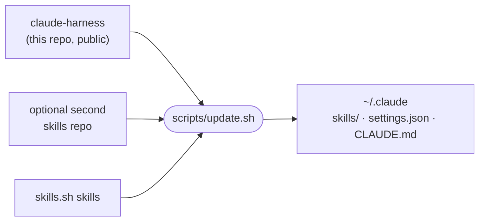

# claude-harness

[](https://github.com/araltiparmak/claude-harness/actions/workflows/check.yml)

A Claude Code setup as code: a set of skills, settings and global instructions, and one script that installs and updates all of it, along with skills from elsewhere.

## How it fits together



`update.sh` pulls this repo and the optional second one, then:

- **Skills:** symlinks every skill into `~/.claude/skills/`, so a pull is all an update needs.
- **Settings:** builds `~/.claude/settings.json` from [`claude/settings.json`](claude/settings.json) plus an optional overlay from the second repo, so private values stay out of this one. If Claude Code or you changed the live file since the last run, the script prints the difference and leaves the file alone, so no setting is lost silently.
- **Global instructions:** links `~/.claude/CLAUDE.md` to [`claude/CLAUDE.md`](claude/CLAUDE.md).
- **skills.sh skills:** runs `npx skills update`, because those skills do not update themselves. Matt Pocock's skills come this way, so no clone of his repo is needed.

[`HARNESS.md`](HARNESS.md) records the plugins and skills.sh installs, so a new machine is two commands away.

[`TOKEN-EFFICIENCY.md`](TOKEN-EFFICIENCY.md) records how plugins, MCP servers, skills and habits are kept cheap in tokens.

## The setup

[`claude/settings.json`](claude/settings.json) in short:

- **Permissions:** auto mode by default. Read-only git, file and search commands and package-manager installs are allowed without asking. `terraform apply`/`destroy`, `.env` and AWS credentials are denied.
- **Hooks:** every Claude Code event goes to iTerm2's `cc-status` utility, so the terminal tab shows whether Claude is working, waiting for permission or done.
- **Status line:** [ccstatusline](https://github.com/sirmalloc/ccstatusline).
- **Model:** Opus at medium effort, with a fallback model.

## Skills

Skills sit in group folders; `update.sh` links each one into `~/.claude/skills/` by its own name. A folder with a `SKILL.md` is a skill, a folder without one is a group.

### Visuals

| Skill | What it does |
|---|---|
| [deck](skills/visuals/deck/SKILL.md) | Builds premium presentation decks (PDF, PNG slides or a presentable HTML file) from a JSON spec for a company-wide audience: results, KPIs, team wins, next steps |
| [diagrams](skills/visuals/diagrams/SKILL.md) | Draws technical diagrams (architecture with AWS icons, message chains, sequence, ER, state, flow) as SVG and PNG with Mermaid, D2 and Graphviz, plain or hand-drawn (whiteboard style), for PRs and docs |
| [infographics](skills/visuals/infographics/SKILL.md) | Builds process, stat-strip, timeline and funnel infographics as PNG, PDF and HTML from HTML templates, and checks the render for overflow, overlap, small text and low contrast |
| [markmap](skills/visuals/markmap/SKILL.md) | Turns a Markdown outline into an interactive mind map (HTML) and a PNG with markmap, for topic trees and study maps |

### Dev

| Skill | What it does |
|---|---|
| [cloudflare](skills/dev/cloudflare/SKILL.md) | Deploys a project to Cloudflare Workers with the cf CLI (no Wrangler file) |
| [mobile-app-stack](skills/dev/mobile-app-stack/SKILL.md) | Recommends the default stack for a new Expo + React Native + TypeScript app, one decision at a time |
| [react-project](skills/dev/react-project/SKILL.md) | Scaffolds a React + Vite + TS + Tailwind prototype via `cra` (project scripts `check` and `ship` included) and builds v1 (user-invoked: `/react-project`) |
| [vercel](skills/dev/vercel/SKILL.md) | Deploys a Vite/React project to Vercel, or repairs its deploy path |

### Todo

| Skill | What it does |
|---|---|
| [todo](skills/todo/SKILL.md) | Adds an item to the current project's `todo.md` checklist, or ticks one off |

A typical run, from idea to live URL:

```text
/react-project habit-tracker 3    scaffold with cra, verify Tailwind, commit, build v1 at effort 3
/vercel                           pin Node and pnpm, write vercel.json, preview, then production
```

## Use these skills

Install any of the skills above with [skills.sh](https://skills.sh):

```bash
npx skills@latest add araltiparmak/claude-harness
```

`react-project` ships its own scaffolder, [`cra.sh`](skills/dev/react-project/cra.sh). It needs Node 24, and creates projects in the folder named by `CRA_DIR` (default `~/dev`).

## Install the whole setup

```bash
git clone https://github.com/araltiparmak/claude-harness.git
claude-harness/scripts/update.sh
```

A second skills repo is optional: point `PRIVATE_DIR` at a checkout (default `~/dev/private-skills`), and set `PRIVATE_URL` to clone it when the folder is missing. Without either, only this repo is installed. `scripts/check.sh` checks the repo's consistency and runs in CI on every push.

## License

[MIT](LICENSE)
