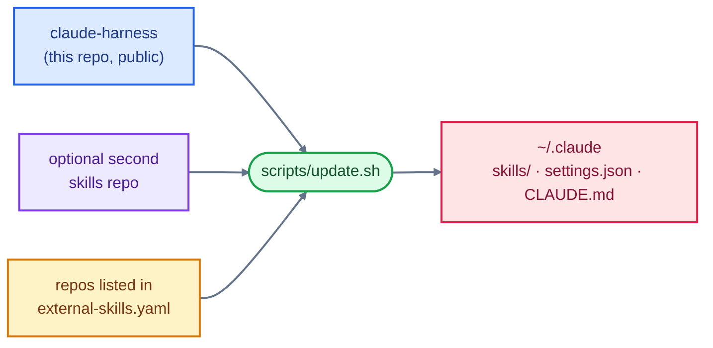

# claude-harness

[](https://github.com/araltiparmak/claude-harness/actions/workflows/check.yml)

A Claude Code setup as code: a set of skills, settings and global instructions, and one script that installs and updates all of it, along with skills from elsewhere.

## How it fits together



`update.sh` pulls this repo and the optional second one, then:

- **Skills:** symlinks every skill into `~/.claude/skills/`, so a pull is all an update needs.
- **Settings:** builds `~/.claude/settings.json` from [`claude/settings.json`](claude/settings.json) plus an optional overlay from the second repo, so private values stay out of this one. If Claude Code or you changed the live file since the last run, the script prints the difference and leaves the file alone, so no setting is lost silently. The model and effort level are the exception: `/model` and `/effort` write them during normal use, so the next run puts the repo's values back.
- **Global instructions:** links `~/.claude/CLAUDE.md` to [`claude/CLAUDE.md`](claude/CLAUDE.md).
- **Skills from other repos:** [`external-skills.yaml`](external-skills.yaml) lists repo URLs and the skills to take from each. The script clones each repo into `~/.cache/claude-harness/repos`, pulls it on later runs, and links the listed skills. Delete a line and the next run unlinks that skill. `scripts/check.sh` checks the file's format.

[`TOKEN-EFFICIENCY.md`](TOKEN-EFFICIENCY.md) records how plugins, MCP servers, skills and habits are kept cheap in tokens.

## The setup

[`claude/settings.json`](claude/settings.json): auto mode; Terraform and Terragrunt `apply`/`destroy`, secrets and large generated files denied; Opus at medium effort. The hooks need iTerm2 (`cc-status`); with another terminal, delete the `hooks` block.

## Skills

Skills sit in group folders; `update.sh` links each one into `~/.claude/skills/` by its own name. A folder with a `SKILL.md` is a skill, a folder without one is a group.

### Visuals

| Skill | What it does |
|---|---|
| [deck](skills/visuals/deck/SKILL.md) | Builds presentation decks (PNG slides or a presentable HTML page) from a JSON spec for a company-wide audience: summary, KPIs, trends, before and after, next steps, or bold one-message slides on bright colour |
| [diagrams](skills/visuals/diagrams/SKILL.md) | Draws technical diagrams (architecture with AWS icons, message chains, sequence, ER, state, flow) as SVG and PNG with Mermaid and D2, plain or hand-drawn (whiteboard style), for PRs and docs |
| [explain](skills/visuals/explain/SKILL.md) | Builds a one-page brief that explains a feature to developers, testers and a PM: scope, architecture (D2, whiteboard style), flow and states (Mermaid), a decision table, rules with test examples, open questions |
| [mindmap](skills/visuals/mindmap/SKILL.md) | Turns a Markdown outline into an interactive mind map (HTML) and a PNG with markmap, for topic trees and study maps |

### Dev

| Skill | What it does |
|---|---|
| [mobile-app](skills/dev/mobile-app/SKILL.md) | Recommends the default stack for a new Expo + React Native + TypeScript app, one decision at a time |
| [react-app](skills/dev/react-app/SKILL.md) | Scaffolds a React + Vite + TS + Tailwind prototype via `cra`, ready for Vercel or Cloudflare (`pnpm ship` checks and deploys), and builds v1 (user-invoked: `/react-app`) |
| [sonar](skills/dev/sonar/SKILL.md) | Reads a PR's SonarQube Cloud findings (issues and hotspots) from the web API, one line each, and fixes them |

### Worklog

| Skill | What it does |
|---|---|
| [worklog](skills/worklog/SKILL.md) | Measures how you use Claude Code (tips, tokens, context, session quality, the most expensive sessions) and what the work was (Jira tickets with outcomes, time and cost, pull requests, reviews), from a `SessionEnd` ledger; `share` writes a page for other readers without the tips (user-invoked: `/worklog`) |

### Todo

| Skill | What it does |
|---|---|
| [eliminate](skills/eliminate/SKILL.md) | Lists the plugins, MCP servers and skills that load into every session with their tokens and recent use, asks section by section which to remove, and removes them; a plugin's skills go only with the plugin (user-invoked: `/eliminate`) |
| [todo](skills/todo/SKILL.md) | Adds an item to the current project's `todo.md` checklist, or ticks one off |

## Use these skills

Install any of the skills above with [skills.sh](https://skills.sh):

```bash
npx skills@latest add araltiparmak/claude-harness
```

`react-app` ships its own scaffolder, [`cra.sh`](skills/dev/react-app/cra.sh). It needs Node 24, and creates projects in the folder named by `CRA_DIR` (default `~/dev`).

## Install the whole setup

```bash
git clone https://github.com/araltiparmak/claude-harness.git
claude-harness/scripts/update.sh
npm i -g ccstatusline   # the status line command in claude/settings.json
```

Plugins are installed by hand: `claude plugin install frontend-design@claude-plugins-official`, and a plugin only one project uses with `--scope project` from that project's folder. A plugin from another marketplace declares that marketplace in the project too, so it stays out of the global settings. For Cloudflare: `claude plugin marketplace add cloudflare/skills --scope project`, then `claude plugin install cloudflare@cloudflare --scope project`. Leave Matt Pocock's `mattpocock-skills` plugin uninstalled; `external-skills.yaml` already links his skills, and the plugin would load them twice.

A second skills repo is optional: point `PRIVATE_DIR` at a checkout (default `~/dev/private-skills`), and set `PRIVATE_URL` to clone it when the folder is missing. Without either, the second repo is skipped; this repo and the skills in `external-skills.yaml` are still installed.

To leave skills off a machine, set `SKIP_SKILLS` to group or skill names separated by spaces, for example `export SKIP_SKILLS="dev mindmap"` in `~/.zshrc`. `update.sh` then links none of them, removes their old links, and prints a `skipped` line for each.

To keep the context small, type `/eliminate`, or run [`scripts/eliminate.py`](scripts/eliminate.py) yourself. It lists every plugin, MCP server and skill, in three sections, that loads into each session, with its token cost and how often your sessions used it in the last 90 days (`eliminate.py 30` for 30). Unused items come first. A skill that a plugin brings is listed as `via plugin <name>` and leaves only with its plugin. Tick the ones to remove in the checklist, confirm, and it takes them out of Claude's context: skills through `SKIP_SKILLS`, plugins through `enabledPlugins`, MCP servers through `claude mcp remove`. It prints the undo for each, and the steps for claude.ai skills and connectors, which only claude.ai or `/mcp` can switch off one by one. `eliminate.py --list` prints the table and changes nothing; `eliminate.py --remove <name>...` removes rows without the checklist. The worklog page's Misc box shows what the same unused items cost in a month.

`scripts/check.sh` checks the repo's consistency and runs in CI on every push, where the deck examples are also built.

## License

[MIT](LICENSE)
