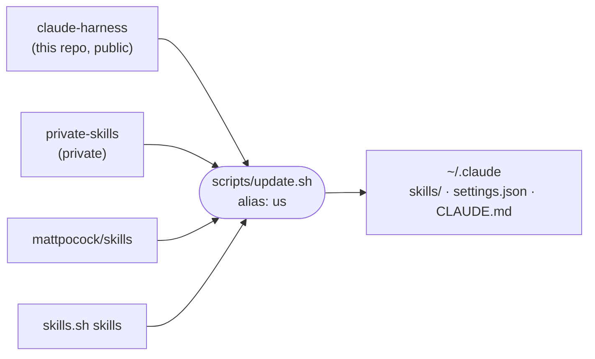

# claude-harness

[](https://github.com/araltiparmak/claude-harness/actions/workflows/check.yml)

My Claude Code setup as code: the skills I wrote, my settings and global instructions, and one script that installs and updates all of it, along with the skills I use from elsewhere.

## How it fits together



`update.sh` pulls the three repos and then:

- **Skills:** symlinks every skill into `~/.claude/skills/`, so a pull is all an update needs. From Matt Pocock's repo it takes the promoted `engineering` and `productivity` buckets; my own skills win any name clash.
- **Settings:** builds `~/.claude/settings.json` from [`claude/settings.json`](claude/settings.json) plus a private overlay, so project names and URLs stay out of this public repo. If Claude Code or I changed the live file since the last run, the script prints the difference and leaves the file alone, so no setting is lost silently.
- **Global instructions:** links `~/.claude/CLAUDE.md` to [`claude/CLAUDE.md`](claude/CLAUDE.md).
- **skills.sh skills:** runs `npx skills update`, because those skills do not update themselves.

[`HARNESS.md`](HARNESS.md) records the plugins and skills.sh installs, so a new machine is two commands away.

## The setup

[`claude/settings.json`](claude/settings.json) in short:

- **Permissions:** auto mode by default. Read-only git, file and search commands and package-manager installs are allowed without asking. `terraform apply`/`destroy`, `.env` and AWS credentials are denied.
- **Hooks:** every Claude Code event goes to iTerm2's `cc-status` utility, so the terminal tab shows whether Claude is working, waiting for permission or done.
- **Status line:** [ccstatusline](https://github.com/sirmalloc/ccstatusline).
- **Model:** Opus at high effort, with a fallback model.

Companion projects:

- [terminal-aliases](https://github.com/araltiparmak/terminal-aliases): `us` runs the update, and `cra` scaffolds the React projects that `react-project` builds on.
- [ccjuice](https://github.com/araltiparmak/ccjuice): a macOS menu bar app that shows how much of my Claude Code usage limit is left.

## Skills

| Skill | What it does |
|---|---|
| [mobile-app-stack](skills/mobile-app-stack/SKILL.md) | Recommends the default stack for a new Expo + React Native + TypeScript app, one decision at a time |
| [note](skills/note/SKILL.md) | Appends a timestamped line to the current project's private `note.md` |
| [react-project](skills/react-project/SKILL.md) | Scaffolds a React + Vite + TS + Tailwind prototype in `~/dev` via `cra` and builds v1 (user-invoked: `/react-project`) |
| [vercel](skills/vercel/SKILL.md) | Deploys a Vite/React project to Vercel, or repairs its deploy path |

A typical run, from idea to live URL:

```text
/react-project habit-tracker 3    scaffold with cra, verify Tailwind, commit, build v1 at effort 3
/vercel                           pin Node and pnpm, write vercel.json, preview, then production
```

## Use these skills

Install any of the skills above with [skills.sh](https://skills.sh):

```bash
npx skills@latest add araltiparmak/claude-harness
```

`react-project` expects the `cra` script from [terminal-aliases](https://github.com/araltiparmak/terminal-aliases) at `~/dev/terminal-aliases/scripts/cra.sh`.

## Install my whole setup

```bash
git clone https://github.com/araltiparmak/claude-harness.git ~/dev/claude-harness
~/dev/claude-harness/scripts/update.sh
```

On a machine without access to `private-skills`, its clone fails and everything else still installs. `scripts/check.sh` checks the repo's consistency and runs in CI on every push.

## License

[MIT](LICENSE)
